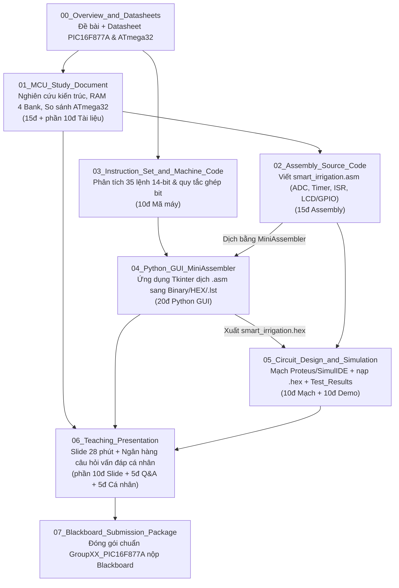

# PIC16F877A Midterm Project — Sơ Đồ Cây & Bảng Theo Dõi Toàn Dự Án

Tài liệu này cung cấp **sơ đồ cây chi tiết đến từng file**, **sơ đồ luồng liên kết các hợp phần**, và **bảng checklist theo dõi tiến độ / điểm số (100 điểm)** cho toàn bộ dự án giữa kỳ vi điều khiển **PIC16F877A**.

---

## 1. Sơ đồ cây toàn bộ thư mục & tập tin (Full Project Tree)

```text
PIC16F877A_Midterm_Project/
│
├── README.md                                                     # Bản đồ tổng quan & checklist theo dõi dự án
│
├── 00_Overview_and_Datasheets/                                   # [NỀN TẢNG] Đề bài, Báo cáo tổng hợp & Datasheet gốc
│   ├── MPS_MIDTERM PROJECT ASSIGNMENT.docx                       # Đề bài gốc của giảng viên (17 mục yêu cầu & Rubric)
│   ├── Mo_Ta_Chi_Tiet_ATmega32_PIC16F877A_va_Midterm_Project.docx# Báo cáo Word tiếng Việt (ATmega32, PIC16F877A, So sánh, Rubric)
│   ├── PIC16F877A_Midterm_Project_Summary.md                     # Tóm tắt nhanh kiến trúc & định hướng đề tài
│   ├── Project_Requirements_Traceability_Matrix.md               # Ma trận truy vết yêu cầu đề bài ↔ sản phẩm
│   └── Datasheets/                                               # Tài liệu kỹ thuật chính hãng (Primary References)
│       ├── ATmega32_Datasheet_doc2503.pdf                        # Datasheet gốc Atmel ATmega32 (đối chiếu Mục 5.9)
│       ├── PIC16F87XA_Datasheet_DS39582C.pdf                     # Datasheet gốc Microchip PIC16F877A (tài liệu chính)
│       └── PICmicro_MidRange_RefManual_DS33023A.pdf              # Sổ tay tham chiếu kiến trúc Mid-Range 14-bit
│
├── 01_MCU_Study_Document/                                        # [MỤC 1 — Section 5 | 15đ Nghiên cứu + 10đ Tài liệu]
│   ├── MCU_Study_Document.pdf                                    # Tài liệu nghiên cứu kỹ thuật hoàn chỉnh (bản PDF nộp bài)
│   ├── MCU_Study_Document_VI.docx                                # Bản Word chỉnh sửa được (Tiếng Việt)
│   ├── MCU_Study_Document_EN.docx                                # Bản Word chỉnh sửa được (Tiếng Anh)
│   ├── ATmega32_vs_PIC16F87XA_Comparison.md                      # Phân tích chi tiết 10 tiêu chí so sánh với ATmega32 (Mục 5.9)
│   └── References.pdf                                            # Danh mục trích dẫn chuẩn kỹ thuật (Mục 5.10)
│
├── 02_Assembly_Source_Code/                                      # [MỤC 2 — Section 6 | 15đ Lập trình Assembly]
│   ├── smart_irrigation.asm                                      # Mã nguồn Assembly thuần 100% (Hệ thống tưới cây thông minh)
│   ├── smart_irrigation.hex                                      # File máy Intel HEX dùng nạp vào mô phỏng
│   ├── smart_irrigation.lst                                      # Bảng Listing đối chiếu Địa chỉ – Mã máy – Dòng lệnh
│   └── Assembly_Documentation.md                                 # Giải thích lưu đồ, thanh ghi, ngắt ISR & kết nối phần cứng
│
├── 03_Instruction_Set_and_Machine_Code/                          # [MỤC 3 — Section 7 | 10đ Giải mã Mã máy & Opcode]
│   ├── Instruction_Set_Opcode_Table.pdf                          # Bảng giải mã 35 lệnh 14-bit PIC16F877A (bản PDF nộp bài)
│   ├── Instruction_Set_Opcode_Table_VI.md                        # Bản chi tiết quy tắc ghép trường bit Opcode (Tiếng Việt)
│   └── Instruction_Set_Opcode_Table_EN.md                        # Bản chi tiết quy tắc ghép trường bit Opcode (Tiếng Anh)
│
├── 04_Python_GUI_MiniAssembler/                                  # [MỤC 4 — Section 8 | 20đ Python Mini Assembler & GUI]
│   ├── MiniAssembler_User_Guide.pdf                              # Tài liệu hướng dẫn sử dụng phần mềm Mini Assembler
│   └── MiniAssembler/                                            # Mã nguồn ứng dụng Python Tkinter (2-Pass Assembler)
│       ├── main.py                                               # Giao diện chính Tkinter GUI (Editor, Bảng Bit-field, Xuất HEX/LST)
│       ├── parser.py                                             # Bộ phân tách nhãn (Label), lệnh, toán hạng & chỉ thị (ORG, EQU)
│       ├── instruction_set.py                                    # Từ điển tra cứu toàn bộ 35 lệnh 14-bit của PIC16F877A
│       ├── encoder.py                                            # Bộ mã hóa nhị phân 14-bit, Hex 4 chữ số & xuất chuẩn Intel HEX
│       ├── error_handler.py                                      # Kiểm tra lỗi cú pháp, tràn miền giá trị & báo số dòng lỗi
│       ├── test_assembler.py                                     # Bộ kiểm thử tự động (Unit Tests) xác minh độ chính xác mã máy
│       ├── README.md                                             # Hướng dẫn chạy nhanh dạng Markdown
│       ├── README.pdf                                            # Hướng dẫn đính kèm gói mã nguồn dạng PDF (theo Mục 8.3)
│       └── examples/                                             # Chương trình mẫu dùng để test trực tiếp trên GUI
│           ├── sample.asm                                        # Mã nguồn Assembly mẫu kiểm thử đủ các nhóm lệnh
│           ├── sample.hex                                        # Kết quả xuất Intel HEX mẫu
│           └── sample.lst                                        # Kết quả xuất Listing mẫu
│
├── 05_Circuit_Design_and_Simulation/                             # [MỤC 5 — Section 9 | 10đ Mạch mô phỏng + 10đ Demo/Test]
│   ├── README_Simulation_Guide.md                                # Sơ đồ đấu nối chân Proteus/SimulIDE, thạch anh & cấu hình Fuse
│   ├── smart_irrigation.asm                                      # Bản sao mã nguồn Assembly đồng bộ với mạch mô phỏng
│   ├── smart_irrigation.hex                                      # Bản sao Firmware nạp trực tiếp vào chip PIC16F877A trên mạch
│   └── Test_Results.pdf                                          # Kịch bản kiểm thử (Test Cases) & kết quả vận hành thực tế
│
├── 06_Teaching_Presentation/                                     # [MỤC 6 — Section 10 | Slide giảng dạy + 5đ Vấn đáp Q&A]
│   ├── Teaching_Slides.pdf                                       # Bộ Slide bài giảng 15–20 trang (28 phút trình bày trên lớp)
│   ├── Teaching_Slides_Notes_and_QnA_VI.md                       # Kịch bản thuyết trình từng slide & Ngân hàng câu hỏi Q&A (VI)
│   └── Teaching_Slides_Notes_and_QnA_EN.md                       # Kịch bản thuyết trình từng slide & Ngân hàng câu hỏi Q&A (EN)
│
└── 07_Blackboard_Submission_Package/                             # [MỤC 7 — Section 11 | Gói nộp chuẩn Blackboard]
    └── GroupXX_PIC16F877A/                                       # Đổi "XX" thành số nhóm trước khi tải lên Blackboard
        ├── MCU_Study_Document.pdf                                # 1. Tài liệu nghiên cứu MCU (PDF)
        ├── Teaching_Slides.pdf                                   # 2. Slide bài giảng (PDF)
        ├── Assembly_Source_Code.zip                              # 3. Gói nén mã nguồn Assembly (.asm, .hex, .lst, tài liệu)
        ├── Simulation_Project.zip                                # 4. Gói nén dự án mô phỏng mạch & firmware
        ├── Python_MiniAssembler.zip                              # 5. Gói nén ứng dụng Python GUI Mini Assembler
        ├── MiniAssembler_User_Guide.pdf                          # 6. Hướng dẫn sử dụng Mini Assembler (PDF)
        ├── Instruction_Set_Opcode_Table.pdf                      # 7. Bảng tập lệnh & mã máy 14-bit (PDF)
        ├── Test_Results.pdf                                      # 8. Báo cáo kết quả kiểm thử (PDF)
        └── References.pdf                                        # 9. Tài liệu tham khảo (PDF)
        # (+ tùy chọn: Demonstration_Video.mp4 nếu không demo trực tiếp)
```

---

## 2. Sơ đồ luồng liên kết giữa các mục trong Project



---

## 3. Bảng theo dõi tiến độ theo Thành viên & Thang điểm (100 điểm)

| Phụ trách gợi ý (Mục 12) | Thư mục theo dõi | Hạng mục chấm điểm (Mục 13) | Điểm | Trạng thái tài liệu | Việc cần rà soát cuối cùng trước bảo vệ |
| :--- | :--- | :--- | :---: | :---: | :--- |
| **Student 1** *(Kiến trúc & Tài liệu)* | `01_MCU_Study_Document/` | Nghiên cứu kiến trúc MCU & Datasheet | **15** | `[x]` Đã có PDF + DOCX | Nắm chắc sơ đồ khối, Bank `RP1:RP0`, bẫy `ADCON1` & RMW, 10 điểm khác ATmega32 |
| **Student 1 + Nhóm** *(Tài liệu & Slide)* | `01_MCU_Study_Document/`<br/>`06_Teaching_Presentation/` | Tài liệu kỹ thuật & Slide giảng dạy | **10** | `[x]` Đã có PDF + Notes | Điền tên nhóm/MSSV vào trang bìa Word/Slide và xuất lại PDF nếu chỉnh sửa |
| **Student 2** *(Assembly & Công cụ)* | `02_Assembly_Source_Code/` | Lập trình Assembly & Giải thích code | **15** | `[x]` Đã có `.asm/.hex/.lst` | Sẵn sàng sửa trực tiếp ngưỡng ADC / chu kỳ Timer khi giảng viên yêu cầu vấn đáp |
| **Student 2** *(Mã máy & Assembler)* | `03_Instruction_Set_.../` | Độ chính xác mã hóa mã máy 14-bit | **10** | `[x]` Đã kiểm thử 35/35 lệnh | Giải thích tay được 1 lệnh Byte (`ADDWF`), 1 lệnh Bit (`BSF`), 1 lệnh Nhảy (`GOTO`) |
| **Student 2** *(Python Tkinter GUI)* | `04_Python_GUI_MiniAssembler/` | Python Mini Assembler & Giao diện GUI | **20** | `[x]` Chạy tốt + Unit Test | Mở sẵn GUI, nạp thử `sample.asm` và `smart_irrigation.asm` để demo trực tiếp |
| **Student 3** *(Phần cứng & Mô phỏng)* | `05_Circuit_Design_.../` | Thiết kế mạch & Mô phỏng Proteus/SimulIDE | **10** | `[x]` Đã có Guide + `.hex` | Lưu file mạch `.pdsprj`/`.simu` kèm ảnh chụp màn hình chạy thực tế vào thư mục `05` |
| **Student 3** *(Kiểm thử & Vận hành)* | `05_Circuit_Design_.../` | Trình diễn hoạt động (Demo) & Kiểm thử | **10** | `[x]` Đã có `Test_Results.pdf` | Demo các trường hợp đất khô / ẩm / ngắt khẩn cấp trên mạch mô phỏng |
| **Cả 3 thành viên** | `06_Teaching_Presentation/` | Kỹ năng giảng dạy & Vấn đáp cá nhân (Q&A) | **5** | `[x]` Đã có kịch bản Q&A | Tập dượt khớp thời lượng 28 phút; mọi thành viên hiểu chéo cả 3 mảng |
| **Cả 3 thành viên** | `07_Blackboard_Submission_.../` | Đóng góp cá nhân & Nộp gói Blackboard | **5** | `[x]` Đã đóng gói `GroupXX` | Đổi tên `GroupXX_PIC16F877A` thành số nhóm thật và cập nhật `.zip` nếu sửa mạch |
| **TỔNG CỘNG** | **8 Thư mục (`00` → `07`)** | **Toàn bộ Midterm Project** | **100** | **Sẵn sàng** | |

---

## 4. Lệnh kiểm tra nhanh khi theo dõi Project

```powershell
# 1. Mở giao diện Python GUI Mini Assembler
python .\04_Python_GUI_MiniAssembler\MiniAssembler\main.py

# 2. Chạy bộ test tự động kiểm tra độ chính xác mã máy 14-bit
python -m unittest discover -s .\04_Python_GUI_MiniAssembler\MiniAssembler -p "test_*.py" -v
```
